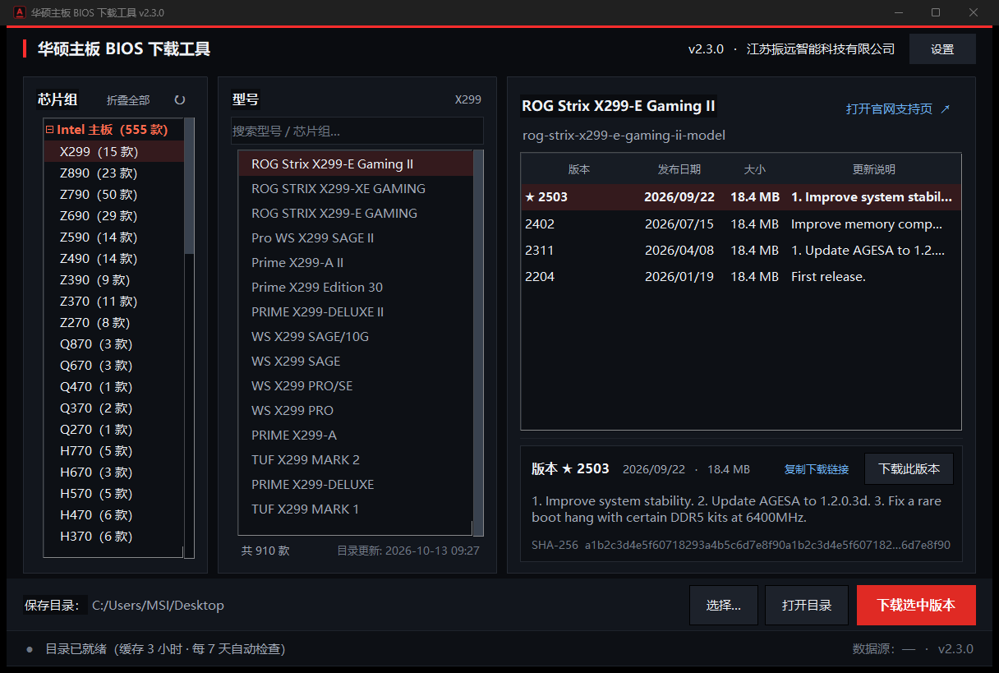

# 华硕主板 BIOS 下载工具

[](https://github.com/355744444-source/asus-bios-downloader/releases/latest)
[](#)
[](#)
[](#)

> ASUS Motherboard BIOS Downloader — Windows 桌面工具，三栏浏览器式界面，内置华硕官网全部在售主板目录，选中型号即列出 BIOS 历史版本并一键下载、SHA-256 校验。



**为什么做这个**：华硕官网查 BIOS 要在支持页里按型号搜索、再逐页翻版本，一次要给几台机器刷 BIOS 时很费事。这个工具把「900+ 款主板 → 芯片组 → 型号 → BIOS 版本」这条路径压成横向三栏，一屏走完。它调用的是官网前端同款 JSON 接口，不是爬 HTML。

---

## 功能

| 能力 | 说明 |
|---|---|
| 三栏浏览 | 左「平台 → 芯片组」/ 中「型号」（平铺 + 实时搜索）/ 右「BIOS 列表 + 选中版本详情」 |
| 跨组搜索 | 中栏输入关键字即跨全部芯片组平铺命中（如 `tuf` → 119 款 / 32 个芯片组），左栏只留含命中的芯片组 |
| 三数据源自动分流 | 普通型号走 `www.asus.com`；大陆渠道 / 特供型号无数据时自动回退 `www.asus.com.cn`；ROG 走 `rog.asus.com` 专用接口 |
| 一键下载 | 官方 CDN 直链，带进度条 / 速度 / 剩余时间 / 取消；支持 `Range` 断点续传 |
| SHA-256 校验 | 下载完成自动与官网公布值比对，不一致明确告警 |
| 自动目录 | 启动拉取全量在售型号并本地缓存（`asus_mb_catalog.json`），之后可离线浏览，按设置间隔自动刷新 |
| DNS 自愈 | 系统 DNS 解析失败（curl error 6/28）时自动切 DoH（阿里 223.5.5.5 / 腾讯 DNSPod）重试，通道逐个试完不中途放弃 |
| 断网自恢复 | 目录更新失败后按 5 / 15 / 45 / 120 秒退避自动重试，覆盖路由器重连、睡眠唤醒后网络未就绪的窗口 |
| 真·高 DPI | 声明 PerMonitorV2，全部度量按真实 DPI 换算，125% / 150% / 200% 原生渲染不发虚 |
| 离线自检 | `--check` 无 GUI 跑通目录接口 / 目录构建 / BIOS 三路径 / 下载直链 |

## 技术要点

- **绕过 Akamai**：官网由 Akamai 保护，`urllib` / `requests` 直接请求会 403。网络层用 `curl_cffi` 的 `impersonate="chrome124"` 伪造 Chrome TLS 指纹。
- **官方接口**（均为官网前端同款 JSON）：
  - `odinapi.asus.com/recent-data/apiv2/SeriesFilter` → 芯片组分类树
  - `odinapi.asus.com/recent-data/apiv2/SeriesFilterResult?Category=63|64` → 平台全量型号（63=Intel / 64=AMD）
  - `odinapi.asus.com/recent-data/apiv2/ModelMapping` → 型号 → `pdid` / `pdhashedid`
  - `www.asus.com/support/webapi/ProductV2/GetPDBIOS` → 普通型号 BIOS 列表
  - `rog.asus.com/support/webapi/product/GetPDBIOS` → ROG 型号 BIOS 列表
- **目录构建**：芯片组码做子串匹配归类（长码优先，`B760M` 命中 `B760`）；Intel / AMD 分桶，归属不到的进「其他」；再由中国站补录大陆特供 / 渠道型号。
- **三路径查询**：prod 型号先全球站（`ModelMapping` 转 hash → `GetPDBIOS?website=global`），无数据回退 `website=cn`；ROG 型号走 `RealProductID` 直连，无需 hash。

## 运行

**直接用**（无需 Python）：到 [Releases](https://github.com/355744444-source/asus-bios-downloader/releases/latest) 下载 `asus-bios-downloader-v2.3.1.exe`，双击运行。首次建目录需联网。

**从源码跑**：

```bash
pip install curl_cffi
python asus_bios_checker.py
```

Windows 10 / 11 x64，Python 3.11+（开发环境 3.13）。

## 构建

```bash
pip install pyinstaller curl_cffi
pyinstaller asus_bios_checker.spec --noconfirm --clean
# 产物：dist/华硕主板BIOS下载工具.exe
```

## 测试

仓库里带了本次重构用的回归门禁，都是可执行的：

| 脚本 | 内容 |
|---|---|
| `_v_audit.py` | 源码态 **159 条**断言：三栏几何、详情面板契约、配色像素采样（PrintWindow 抓真实窗口，不用 `style.lookup` —— 它返回配置值不等于渲染值）、事件抑制、DPI 换算 |
| `_v_frozen.py` | 打包态 **101 条**断言：产物版本资源、无旧版残留常量、冷目录 `--check` |
| `_probe_part.py` | 取消下载不残留半截 `.part` |
| `_probe_cfg.py` | 目录未加载时的设置保存语义 |
| `_probe_doh_chain.py` | 备用解析（DoH）链路不会被中途异常截断 |
| `_probe_cat_retry.py` | 目录更新失败后的文案 / 自动重试调度 |

```bash
python _v_audit.py            # → PASS 159 / FAIL 0
python _probe_part.py
python _probe_cfg.py
python _probe_doh_chain.py
python _probe_cat_retry.py
```

`_probe_part.py`、`_probe_cfg.py` 是从真实缺陷反推的回归探针：修复前 `.part` 残留 1,000,000 字节，修复后目录为空。

## 项目结构

```
asus_bios_checker.py     主程序（单文件，GUI + 网络 + 目录）
asus_bios_checker.spec   PyInstaller 打包配置
version_info.txt         Windows 版本资源
asus_mb_catalog.json     型号目录缓存（约 910 款）
asus_bios.ico            图标
README.txt               面向使用者的详细手册
CHANGELOG.md             版本历史（含每个缺陷的实测证据）
_v_audit.py / _v_frozen.py / _probe_*.py   回归门禁
docs/                    截图
```

## 说明

- 本工具只做「查询 + 下载官网公开文件」，不修改、不破解任何东西。刷 BIOS 有风险，写盘前请确认型号与版本。
- 官网接口与 CDN 直链由华硕提供，本工具不托管任何 BIOS 文件；如遇接口变更需要更新。
- 界面文案与代码注释为中文。

## 许可

暂未指定开源许可证（All rights reserved）。如需引用或分发请先联系。
